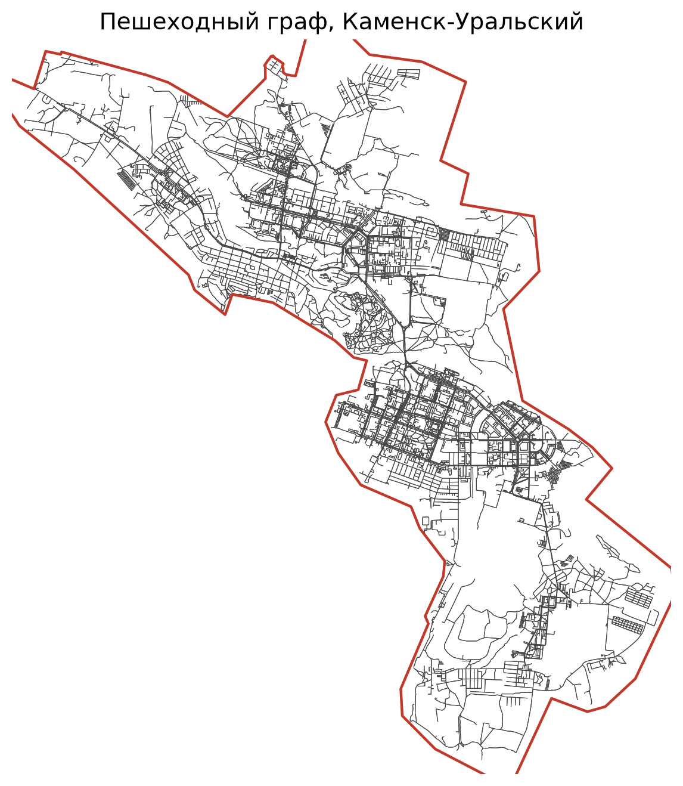
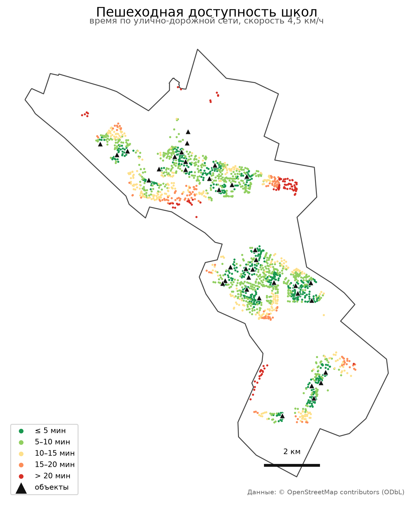
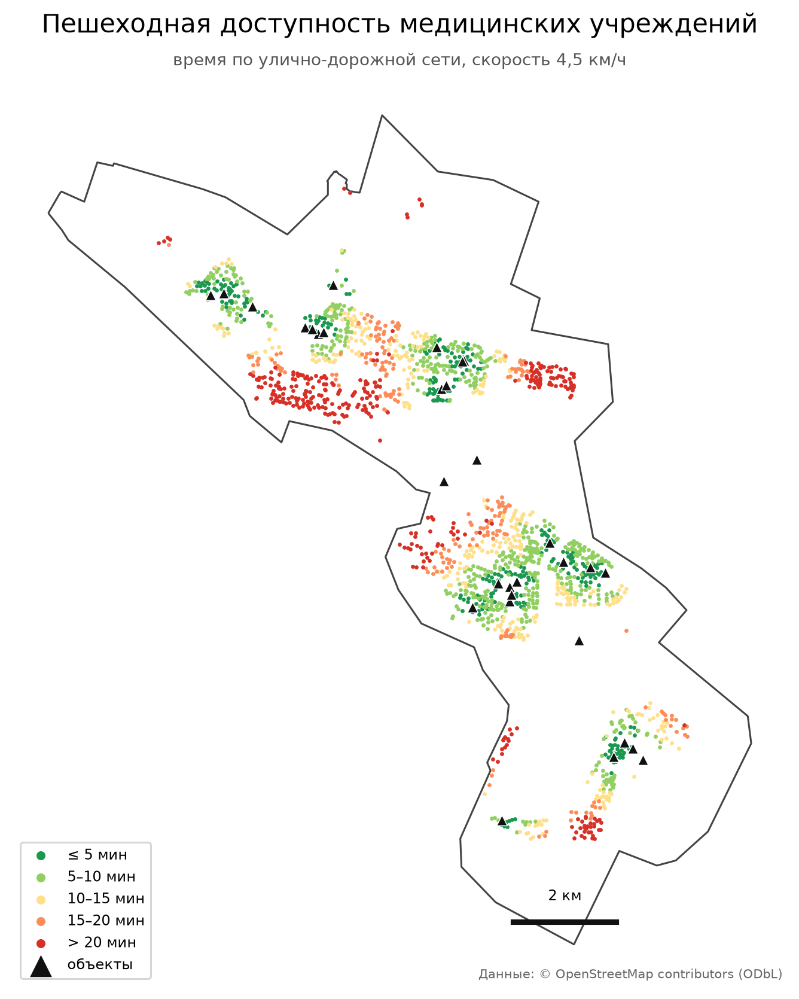
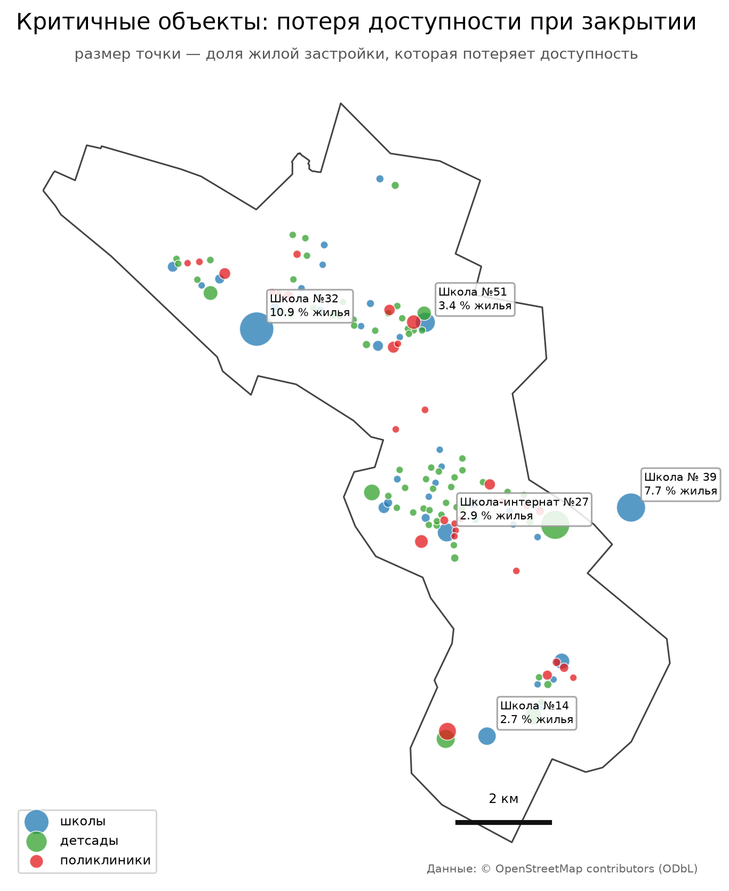

# Адаптация сети социальной инфраструктуры к сокращению населения: ГИС-анализ пешеходной доступности в Каменске-Уральском

ГИС-оценка пешеходной доступности школ, детских садов и медицинских учреждений в
Каменске-Уральском (Свердловская область, ~160 тыс. человек) и сравнение сценариев
адаптации сети к сокращению населения.

**Веб-карта:** [geraks7.github.io/kamensk-accessibility](https://geraks7.github.io/kamensk-accessibility/)

**Тизер проекта (PDF, 1 страница):** [teaser.pdf](teaser.pdf)

## Исследовательский вопрос

Как изменение сети социальных объектов влияет на пространственную доступность услуг и
какие сценарии адаптации позволяют эффективнее использовать существующую инфраструктуру
без существенного ухудшения доступности?

## Гипотеза

Сеть социальной инфраструктуры Каменска-Уральского пространственно избыточна относительно
текущей численности населения: значимая часть объектов имеет перекрывающиеся зоны
15-минутной пешеходной доступности, и сокращение таких объектов не выводит жилые
территории за нормативный порог. При этом доступность распределена неравномерно:
отдалённые посёлки остаются вне 15-минутной зоны независимо от сценария сокращения,
поэтому для них требуются не закрытие объектов, а иные формы обслуживания.

## Критерии проверки

| Показатель | Как считается | Что означает |
|---|---|---|
| Доля жилой застройки в зоне доступности | доля зданий с временем до объекта ≤ порога (10/15/20 мин) | базовая обеспеченность |
| Индекс дублирования | доля зданий, от которых в пределах порога доступны 2+ объекта | избыточность сети |
| Потеря покрытия при сценарии | изменение доли покрытия после исключения объекта, % | цена сокращения |
| Доля территорий вне порога | здания, недоступные при любом сценарии | зона особого внимания |
| Разрыв «норматив — факт» | нормативный радиус vs фактическая пешеходная доступность | где норматив не работает |

## Практический результат

- реестр объектов с оценкой «избыточен / критичен для доступности»;
- три сценария адаптации сети (умеренный, средний, радикальный) с количественной
  оценкой потери доступности и высвобождаемых площадей;
- набор тематических карт;
- воспроизводимый алгоритм расчёта с оценкой чувствительности и ограничениями модели.

## Зачем это

Город теряет население с 1989 года (207 780 → 160 312 человек по Росстату), но сеть
социальных объектов осталась рассчитанной на большее число жителей. Решения о сокращении
сети обычно принимаются по количеству объектов или общей численности населения — без
проверки того, кого именно эти решения оставят без услуги. Проект предлагает
пространственный критерий для таких решений.

## Нормативный baseline

Сценарии сравниваются не только между собой, но и с нормативом: пороговые радиусы
обслуживания из СП 42.13330 (детские сады — 300 м, школы — 500 м, поликлиники — 1000 м;
проверить по актуальной редакции). Это даёт внешний критерий: сеть может быть избыточной
по нормативу и одновременно дефицитной по фактической пешеходной доступности.

## Статус

- [x] Структура репозитория, источники данных, постановка задачи
- [x] Скрипт построения пешеходного графа и первой карты (`src/01_city_map.py`)
- [x] Слой объектов социальной инфраструктуры из OSM (`src/02_poi.py`)
- [x] Расчёт доступности, дублирования и нормативного baseline (`src/03_accessibility.py`)
- [x] Сценарии сокращения сети и реестр объектов (`src/04_scenario.py`)
- [x] Тематические карты (`src/05_maps.py`)
- [x] Веб-карта (`src/06_webmap.py`, GitHub Pages)
- [x] Презентация 8 слайдов (`src/07_presentation.py`)
- [x] Сверка школ и детсадов с официальным перечнем `obr-ku.ru`
- [x] Проверка медицинских площадок основного поставщика (7 из 7 найдены в OSM)
- [x] Аналитическая записка (`src/08_report.py` → `report.docx`, 9 страниц)
- [x] Одностраничный тизер (`src/09_teaser.py` → `teaser.pdf`)
- [x] Полная сверка медучреждений по всем юрлицам

## Структура репозитория

```
kamensk-accessibility/
├── data/
│   ├── raw/          # исходные данные и официальные перечни
│   └── processed/    # geodata: границы, POI, расчёт доступности
├── src/
│   ├── common.py             # общие пути и загрузчики
│   ├── 01_city_map.py        # граница ГО + пешеходный граф + первая карта
│   ├── 02_poi.py             # объекты социальной инфраструктуры из OSM
│   ├── 02b_official_poi.py   # официальные перечни школ и детсадов
│   ├── 02c_verify_poi.py     # сверка OSM с перечнями + геокодирование
│   ├── 02d_medical_check.py  # проверка медицинских площадок
│   ├── 03_accessibility.py   # доступность, дублирование, нормативный baseline
│   ├── 04_scenario.py        # сценарии адаптации сети
│   ├── 05_maps.py            # статические карты
│   ├── 06_webmap.py          # интерактивная карта
│   ├── 07_presentation.py    # презентация
│   ├── 08_report.py          # аналитическая записка
│   └── 09_teaser.py          # тизер на одну страницу
├── maps/             # готовые карты (PNG)
├── docs/
│   ├── DATA.md       # источники данных и их ограничения
│   ├── METHOD.md     # методика, допущения, чувствительность
│   └── index.html    # веб-карта (GitHub Pages)
├── presentation.pptx # презентация на 8 слайдов
├── report.docx       # аналитическая записка, 9 страниц
├── teaser.pdf        # тизер на одну страницу A4
├── requirements.txt
└── README.md
```

## Данные

| Данные | Источник | Формат |
|---|---|---|
| Улично-дорожная сеть, здания, POI | OpenStreetMap | PBF |
| Граница городского округа | OSM relation 1298867 | полигон |
| Школы и детсады (адреса, номера) | obr-ku.ru | HTML |
| Медицинские площадки | medkamensk.ru | HTML |
| Население, ввод жилья (контекст) | ЕМИСС / БД ПМО | XLSX |

Подробно — в [docs/DATA.md](docs/DATA.md).

## Сверка с официальными перечнями

Муниципальные перечни (`obr-ku.ru`) сопоставлены с OSM по номеру учреждения:

| Тип | Официально | В OSM | Совпало | Нет в OSM | Лишние в OSM |
|---|---|---|---|---|---|
| Школы | 31 (29 с номером) | 34 | 27 | 2 (№11, №39) | 4 (№4, 13, 23, 24) |
| Детские сады | 51 | 64 | 48 | 3 (№11, 15, 90) | 10 (№16, 20, 27, 38, 42, 53, 56, 59, 93, 94) |

Что сделано:

- из OSM удалены ложные объекты — танцевальная студия и детская художественная школа,
  размеченные как `amenity=school`;
- недостающие муниципальные объекты геокодированы по адресам и добавлены (5 объектов);
- объекты, которых нет в муниципальном перечне, оставлены со статусом «прочие»
  (региональные, ведомственные, частные).

Итоговый слой: 134 объекта — 36 школ, 67 детских садов, 31 медицинское учреждение;
из них 85 муниципальных.

Отчёт: `data/processed/poi_verification.csv`, журнал геокодирования —
`data/raw/official_missing_geocoded.csv`.

### Медицинские учреждения

Полного машиночитаемого реестра городской сети нет: PDF МИАЦ содержит только сельские
ОВП и ФАП, а городская медицина разбита между несколькими юрлицами (городская больница,
городская поликлиника, детская больница, диспансеры, частные клиники).

Что удалось проверить: **7 площадок ГАУЗ СО «Городская больница г. Каменск-Уральский»**
(корпуса 1–3, поликлиники 1–3, женская консультация №1) по данным
[medkamensk.ru](https://medkamensk.ru/ob-uchrezhdenii/organizatsionnaya-struktura/).
Все 7 найдены в OSM в радиусе 50 м — расхождений нет.

Отчёт: `data/processed/medical_verification.csv`. Остальные поставщики остаются
непроверенными — это ограничение, а не утверждение о полноте.

## Метод

1. Пешеходный граф города по OSM (`osmnx`), проекция в UTM 41N.
2. Привязка объектов инфраструктуры и жилой застройки к узлам графа.
3. Кратчайшие расстояния по сети от жилой застройки до ближайшего объекта каждого типа.
4. Перевод расстояний во время при скорости 4 и 5 км/ч; пороги 10 / 15 / 20 минут.
5. Покрытие и индекс дублирования по каждому типу объектов.
6. Сравнение с нормативными радиусами (прямолинейное расстояние).
7. Сценарии сокращения сети с оценкой потери покрытия.

Подробно о модели, допущениях и оценке чувствительности — в [docs/METHOD.md](docs/METHOD.md).



*Пешеходный граф города по данным OSM: 8 167 узлов, 23 452 ребра.*

## Оценка чувствительности

Результаты пересчитываются при:

- пороге доступности: 10 / 15 / 20 минут;
- скорости пешехода: 4 и 5 км/ч;
- составе объектов (только муниципальные / все, включая частные);
- границах территории (город / городской округ с посёлками).

## Результаты

Данные: 6 029 жилых зданий, 1 752 узла спроса; пешеходный граф — 8 167 узлов, 23 452 ребра.
Объекты (после сверки с официальным перечнем): 36 школ, 67 детских садов, 31 медицинское учреждение.

**Покрытие при 4,5 км/ч:**

| Тип | 10 мин | 15 мин | 20 мин | Медианное время |
|---|---|---|---|---|
| Школы | 48 % | 75 % | 90 % | 7,6 мин |
| Детские сады | 49 % | 66 % | 80 % | 6,2 мин |
| Поликлиники | 30 % | 46 % | 61 % | 10,4 мин |

**Дублирование (15 мин):** 40 % жилья имеет 2+ школы в зоне доступности, 47 % — 2+ детских
сада, 35 % — 2+ медицинских учреждения. Одновременно 25 %, 34 % и 54 % жилья не имеют
ни одного объекта в пределах 15 минут. То есть избыточность и дефицит существуют
одновременно — в разных частях города.

**Норматив против сети** (одно и то же расстояние, измеренное по прямой и по улицам):

| Тип | Радиус | По прямой | По сети | Разрыв |
|---|---|---|---|---|
| Школы | 500 м | 72 % | 28 % | −43 п.п. |
| Детские сады | 300 м | 59 % | 13 % | −45 п.п. |
| Поликлиники | 1 000 м | 76 % | 41 % | −35 п.п. |

Главный вывод: нормативные радиусы, посчитанные по прямой, завышают доступность в
1,5–4 раза. Уличная сеть и барьеры «съедают» от 35 до 45 процентных пунктов норматива.

### Сценарии сокращения сети

Жадный алгоритм убирает объекты, пока потеря покрытия не превышает заданный бюджет.
Ограничение — не более половины сети на тип: модель оценивает доступность, а не
вместимость, поэтому формально «без потерь» можно убрать почти всё.

| Сценарий | Тип | Убрано объектов | Покрытие до | Покрытие после | Среднее время до | После |
|---|---|---|---|---|---|---|
| умеренный (0 %) | школы | 12 из 36 | 74,9 % | 74,9 % | 11,3 мин | 11,6 мин |
| умеренный (0 %) | детсады | 33 из 67 | 66,3 % | 66,3 % | 12,5 мин | 13,2 мин |
| умеренный (0 %) | поликлиники | 10 из 31 | 45,8 % | 45,8 % | 17,2 мин | 17,3 мин |
| средний (1 %) | школы | 17 из 36 | 74,9 % | 74,3 % | 11,3 мин | 11,9 мин |
| средний (1 %) | детсады | 33 из 67 | 66,3 % | 66,3 % | 12,5 мин | 13,2 мин |
| средний (1 %) | поликлиники | 15 из 31 | 45,8 % | 45,4 % | 17,2 мин | 17,5 мин |

Ключевой эффект: даже при «нулевой потере покрытия» среднее время до объекта растёт.
Двоичный показатель доступности скрывает ухудшение, которое видно по времени.

**Самые критичные объекты** (потеря жилья при удалении только этого объекта):
Школа №32 — 10,9 %, Школа №39 (Монастырка) — 7,7 %, Школа №51 — 3,4 %;
Детский сад №34 — 7,7 %; Общая врачебная практика — 2,6 %.
Школа №39 появилась в расчёте именно после сверки: её не было в OSM, а без неё
7,7 % жилья оставались без школы в 15 минутах.

Полные таблицы: `data/processed/scenario_summary.csv`, `scenario_objects.csv`,
`critical_objects.csv`.

### Карты







## Запуск

```bash
python -m venv .venv
.venv\Scripts\activate          # Windows
pip install -r requirements.txt

python src/01_city_map.py
python src/02_poi.py
python src/02b_official_poi.py
python src/02c_verify_poi.py
python src/02d_medical_check.py
python src/03_accessibility.py
python src/04_scenario.py
python src/05_maps.py
python src/06_webmap.py
python src/07_presentation.py
python src/08_report.py
python src/09_teaser.py
```

Результаты третьего шага: `data/processed/accessibility.gpkg`,
`data/processed/coverage_summary.csv`, `data/processed/duplication.csv`,
`data/processed/normative_baseline.csv`.

Результаты четвёртого шага: `data/processed/scenario_summary.csv`,
`scenario_objects.csv`, `critical_objects.csv`, `critical_objects.gpkg`.

## Ограничения

- Население по кварталам не публикуется — используется прокси по числу жилых зданий.
- Объекты сверены с муниципальным перечнем, но геокодирование добавленных точек
  выполнено по адресу и может иметь погрешность 50–100 м.
- Пешеходная сеть OSM неровная: тротуары и переходы покрыты неравномерно.
- Вместимость объектов в открытых данных отсутствует — оценивается доступность,
  а не загрузка мест.
- Оценка чувствительности к составу объектов ограничена доступными данными.

## Лицензия

Код — MIT. Данные OSM — © OpenStreetMap contributors, ODbL 1.0.
